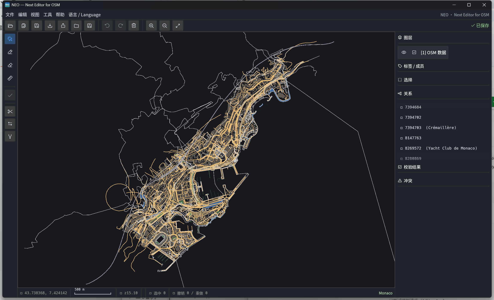

# NEO — Next Editor for OSM

<div align="center">

**Native Rust, GPU-first OpenStreetMap editor** · millions to tens of millions of objects · JOSM-style UI

[](https://github.com/TrapMeHere/NEO/actions/workflows/ci.yml)
[](https://github.com/TrapMeHere/NEO/releases)
[](https://trapmehere.github.io/NEO/)
[](LICENSE)
[](Cargo.toml)

[Docs site](https://trapmehere.github.io/NEO/) ·
[User guide](docs/guide/quick-start.md) ·
[Developer guide](docs/dev/architecture.md) ·
[Releases](https://github.com/TrapMeHere/NEO/releases) ·
[CHANGELOG](CHANGELOG.md) ·
[TODO](TODO.md)

</div>



## Features

- **Native performance**: Rust + wgpu (DX12/Vulkan/Metal); rebuilding the viewport scene for 1M objects takes ~1.3 ms, and picking takes 8–22 µs ([measurements](docs/14-performance-and-verification.md))
- **Complete data core**: SoA + Arena + generational handles, rstar index, parallel PBF import (~1.8M elem/s)
- **Reliable editing**: Command/Transaction/Undo/Redo, journal-based crash recovery, referential-integrity checks
- **Multiple layers**: the active layer is editable; inactive layers are 50% dimmed, read-only, still rendered and persisted; create a layer or open a file as a layer, switch, show/hide, delete
- **Rendering**: wgpu vector map, node LOD, drawing grouped by OSM `layer` (tunnel/bridge/elevated), name labels; solid bridge casing, dashed tunnel casing (implicit layer ±1), gold ladder hachures for embankments / brick-red comb hachures for cuttings, and water surface for fords
- **Editing tools**: select/box-select/draw/delete/measure, drag to move, split path at point, merge end-to-end paths, reverse/simplify ways, node glue, align/distribute/mirror/unglue/parallel copy, tag table (multi-select can edit tags in bulk)
- **Upload**: full upload or selected-only upload (new dependencies included automatically), validation-error gate, 409 conflict handling
- **Settings**: general/language/account/editing/validation/network/storage/shortcuts (rebindable), persisted to `neo-state.json`
- **Relation editing**: add/remove/reorder members, edit roles, undoable
- **Clipboard**: copy/paste/duplicate (across documents, IDs remapped automatically)
- **Search**: `id:123`, `key=value` or tag text, with jump-to-result
- **Validator**: 24 JOSM-style rules (way too short/long, duplicate nodes/non-adjacent duplicates, unclosed buildings/areas, duplicate ways, orphan nodes, duplicate coordinates, suspicious tags, multipolygon roles and outer, self-intersection, closed way with too few nodes, relation without `type`, duplicate members, invalid/out-of-range `layer`, invalid `oneway`, empty `name`, etc.); run and jump from the panel
- **Presets**: generated at build time from **id-tagging-schema** and **name-suggestion-index** into `assets/presets/` and loaded at runtime (not embedded in the exe); the tag panel searches the schema by default and also suggests brands while typing
- **MapCSS styles**: default `neo.mapcss` plus a subset parser resolving color/fill/width by tag and zoom
- **OSM account and upload**: built-in OAuth client + PKCE, multiple saved accounts; changeset upload (full or selected-only) and 409 conflict handling live in File → Upload…; downloading is a separate window (bbox selection / Overpass)
- **Unified export**: File → Export… choose OSM XML / osmChange / PBF / session
- **Autosave**: journal snapshots + SQLite snapshot store (WAL); recoverable at startup
- **File formats**: read/write PBF / OSM XML / osmChange / GPX, JOSM sessions `.jos`/`.joz`
- **Internationalization**: English-first UI (default) with translations for Simplified/Traditional Chinese, French, German, Russian, Arabic (Egypt), Vietnamese, Japanese, Korean and Malay (`i18n/` + `neo-i18n`); the app detects the OS locale at startup to pick the UI language (`NEO_LANG` overrides) and missing translations fall back to English (zh-TW → zh-CN first); CJK/Unifont fonts live under `assets/fonts/` (not embedded in the exe)

> Status: **v0.1.0 in development**. Phases 2/3 are complete; code for phases 4–6 has landed but not all gates are green (plugin isolation passes; three-platform installers and the 10M/1h stability run have not been re-verified). See
> [roadmap](docs/16-roadmap-and-risks.md) and [TODO](TODO.md).

## Download and installation

Download `neo-desktop-vX.Y.Z-windows-x86_64.zip` from
[Releases](https://github.com/TrapMeHere/NEO/releases), extract it and run `neo-desktop.exe`.

```powershell
# Optional: verify SHA256
Get-FileHash .\neo-desktop-v0.1.0-windows-x86_64.zip -Algorithm SHA256
```

Building from source (Rust 1.97+; on Windows you need MSVC Build Tools + Windows SDK; preset generation needs Node.js 22 and `npm ci`):

```bash
npm ci
cargo build --release -p neo-desktop
./out/cargo/release/neo-desktop
```

If Node is unavailable, run `node scripts/build-presets.mjs` in an environment that has it, put
`assets/presets/schema.neo` and `suggestions.neo` into the repository, and build (build.rs reuses existing files).
System requirements: Windows 10/11 x64 (primary support); Linux/macOS can build from source.
See [installation docs](docs/guide/installation.md) for details.

## Quick start

1. The map starts empty. Use **File → Open PBF… / Open OSM XML…**, or the toolbar's OSM download button
2. `S` select, `A` draw, `X` delete, `M` measure; right-drag to pan, scroll to zoom
3. Left-drag to move nodes/ways; `Enter` finishes a line; `Ctrl+Z/Y` undo/redo
4. `Ctrl+S` saves XML, or **File → Export osmChange / PBF**
5. **Help → Settings…** switches the language and shows shortcuts

Full tutorial: [quick start](docs/guide/quick-start.md) ·
[interface](docs/guide/interface.md) ·
[editing](docs/guide/editing.md) ·
[FAQ](docs/guide/faq.md)

## Documentation

| Entry | Contents |
|---|---|
| [Docs site](https://trapmehere.github.io/NEO/) | Tutorials + developer guide + technical design (mdBook) |
| [docs/introduction.md](docs/introduction.md) | Project introduction and screenshots |
| [docs/guide/](docs/guide/quick-start.md) | Installation, quick start, interface, editing, files/sessions, settings, performance, FAQ |
| [docs/dev/](docs/dev/architecture.md) | Architecture, workspace, build/test, contributing, release, roadmap |
| [docs/01](docs/01-system-architecture.md)–[18](docs/18-testing-strategy.md) | Technical design documents |
| [docs/adr/](docs/adr/) | Architecture decision records |

Local docs preview:

```bash
cargo install mdbook --version 0.4.52 --locked
mdbook serve --open
```

## Development

```bash
npm ci
cargo fmt --all --check
cargo clippy --workspace --all-targets -- -D warnings
cargo check --workspace
cargo test --workspace
python scripts/check-deps.py
python scripts/check-i18n.py
```

Tests run on `master`; CI runs the full test suite on every push and pull request.

- [Contributing guide](CONTRIBUTING.md) (DCO, code style, clean-room rules)
- [Build and test](docs/dev/build-and-test.md)
- [Workspace and crate responsibilities](docs/dev/workspace.md)
- [Release process](docs/dev/release.md)

## Project layout

```
crates/
  neo-core      IDs/coordinates/handles/Meta   neo-store    DataSet/index/referrers
  neo-osm       OSM entities/changes/tags      neo-geo      camera/projection/picking
  neo-scene     LOD/batching/vertices          neo-render   wgpu pipelines/GpuScene
  neo-io        PBF/XML/OSC                    neo-editor   commands/transactions/history/journal
  neo-tools     editing actions                neo-persist  sessions .jos/.joz
  neo-ui        egui panels/theme              neo-i18n     text catalogs
apps/
  neo-desktop   eframe + wgpu desktop app      neo-prototype performance prototype
docs/           technical design + user/developer guides (mdBook)
i18n/           en-US + zh-CN/zh-TW + fr/de/ru/ar/vi/ja/ko/ms translations
.github/        CI / Release / Pages / templates
```

Dependency direction and invariants: [docs/02](docs/02-workspace-and-dependency-rules.md) and
[docs/dev/architecture.md](docs/dev/architecture.md).

## Contributing

Issues and PRs are welcome! Please read [CONTRIBUTING.md](CONTRIBUTING.md) and the
[Code of Conduct](CODE_OF_CONDUCT.md) first. Report security issues privately as described in
[SECURITY.md](SECURITY.md).

## License

- Code: **Apache-2.0 OR MIT** (see [LICENSE](LICENSE), [LICENSE-MIT](LICENSE-MIT), [LICENSE-APACHE](LICENSE-APACHE))
- Documentation: **CC-BY-SA-4.0**
- Third-party fonts/icons and OSM data attribution: see [NOTICE](NOTICE) and [assets/fonts/NOTICE.md](assets/fonts/NOTICE.md)
- OSM data © OpenStreetMap contributors, ODbL 1.0
