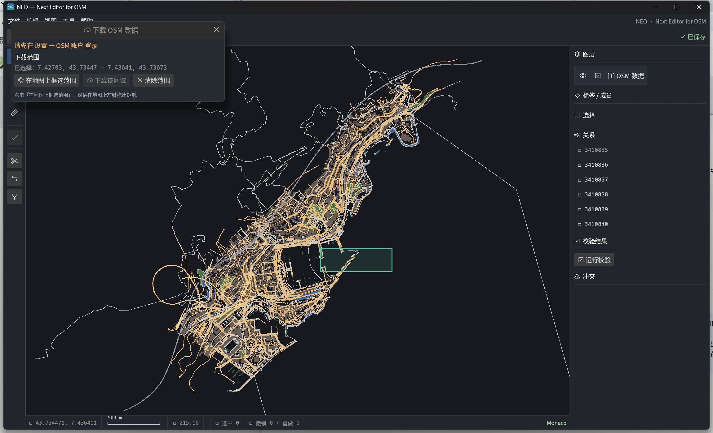
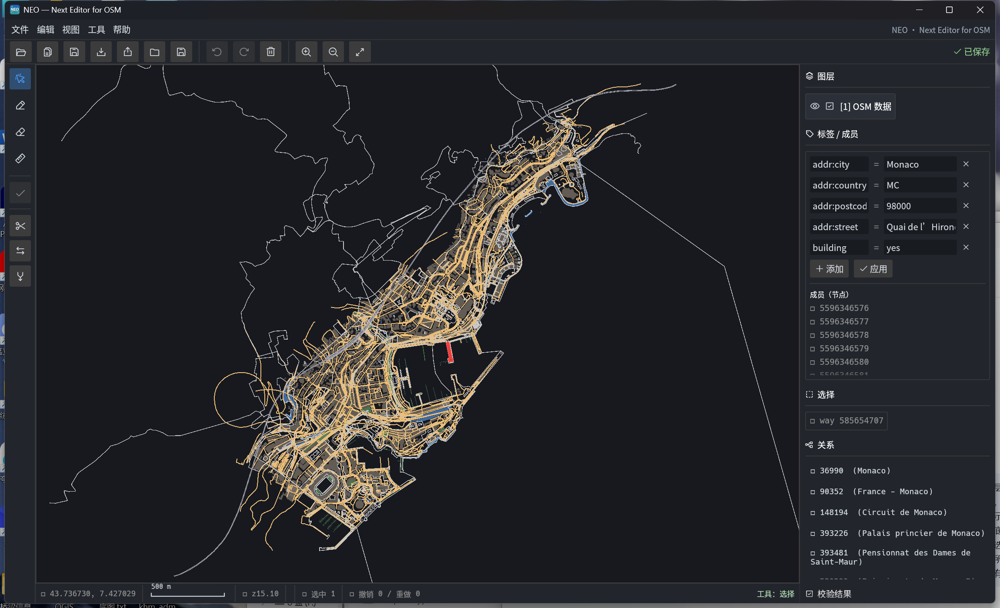
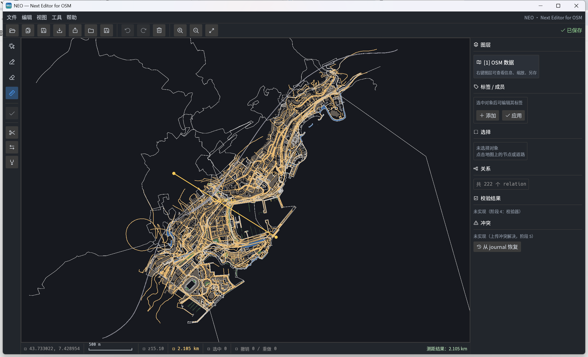

# 快速上手

## 1. 启动并打开数据

启动后地图为空，需要自行载入数据：

- **文件 → 打开 PBF…** 选择 `.osm.pbf`
- **文件 → 打开 OSM XML…** 选择 `.osm` / `.xml`
- 或用工具栏 **下载 OSM 数据** 框选区域从 API 拉取

导入大文件时状态栏会显示进度；`Esc`/取消按钮可中止并行导入。

## 2. 下载 OSM 数据（可选）

工具栏第一个图标（云下载）打开 **下载 OSM 数据** 窗口：

1. 点「在地图上框选范围」
2. 在地图上左键拖出矩形（绿色框）
3. 点「下载该区域」即可从 OSM API 下载并替换当前图层

也可以 **文件 → 打开 PBF… / 打开 OSM XML…** 导入本地文件。

## 3. 导航

| 操作 | 效果 |
|---|---|
| 右键拖动 | 平移地图 |
| 滚轮 | 以鼠标位置为中心缩放 |
| 工具栏放大/缩小/缩放至数据 | 视图操作 |
| 状态栏左下 | 鼠标经纬度 + 比例尺 |

节点按缩放级别显示（LOD）：

- `z ≤ 16`：不显示节点
- `z 17–18`：只显示被 ≥2 条 way 共享的节点（小点）
- `z ≥ 19`：显示全部节点（共享节点方块、普通节点圆点）

## 4. 选择与查看

- **选择工具（S）**：左键点击要素，红色高亮；Ctrl+点击追加选择
- 右侧 **标签 / 成员** 面板显示全部标签；way/relation 底部显示成员
- **关系** 面板列出全部 relation；**选择** 面板列出当前选择
- 右键图层 → **信息…** 查看计数、版本、脏对象、视口中心

## 5. 编辑

- **左键拖拽**：拖动节点或整条 way（先自动选中，松开才写数据）
- **绘制（A）**：依次点击画线，`Enter` 完成
- **删除（X）**：点击要素删除
- **Ctrl+Z / Ctrl+Y**：撤销/重做
- **Delete**：删除当前选择
- 分割 / 反转 / 合并按钮在左侧工具箱与工具栏

## 6. 保存

- **文件 → 导出…** 打开统一导出窗口，选择 OSM XML / osmChange / PBF / JOSM 会话
- **Ctrl+S** 快捷保存 XML
- 导出会话（`.jos`/`.joz`）会保留视图与选择

## 7. 测距

按 `M` 或点击左侧标尺图标：第一次点击起点，第二次点击终点，
地图显示黄色连线与距离，状态栏同步显示 m/km。

## 8. 下一步

- [界面说明](interface.md) — 每个面板的用途
- [编辑操作](editing.md) — 细节与快捷键
- [文件、会话与恢复](files-and-sessions.md) — 数据安全
