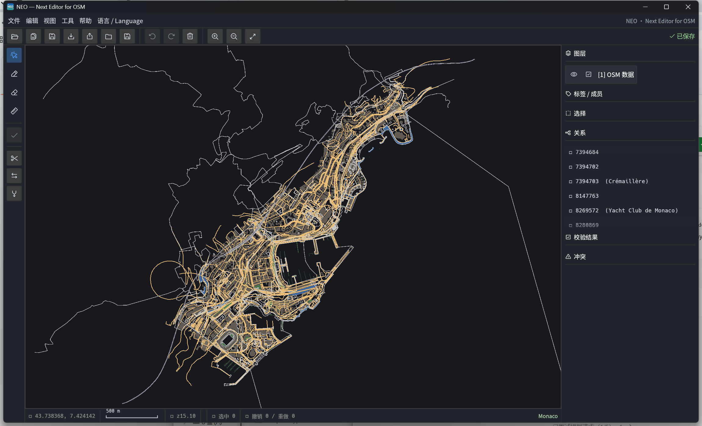

# NEO — Next Editor for OSM

**Rust 原生、GPU-first 的 OpenStreetMap 编辑器**，目标是完整替代 JOSM，而不是轻量地图查看器。

- 平台：Windows 10/11（主要），Linux / macOS 可源码构建
- 规模：百万到千万级 OSM 对象
- 架构：Rust Core + wgpu Renderer + egui UI + 并行引擎

> 当前版本 **0.1.0**：阶段 2（数据核心）与阶段 3（编辑）已完成；**阶段 4 进行中**，
> 已交付：JOSM 风格校验器（24 条规则 + 面板定位）、id-tagging-schema 与 name-suggestion-index 预设、OSM API 0.6 协议客户端（changeset/diff/409 解析）、
> 冲突合并模型（MergeCase + 6 类测试）、journal 恢复报告。
> 仍待完成：MapCSS 渲染集成、真实 HTTP 上传 UI、自动保存、冲突解决 UI。

## 这个文档站

- **用户指南**：安装、快速上手、界面、编辑、文件与会话、设置、性能、FAQ
- **开发指南**：架构、workspace、构建测试、贡献流程、发布流程
- **技术设计**：`docs/01`–`docs/18` 与 ADR，是架构事实来源

## 链接

- 代码仓库：<https://github.com/TrapMeHere/NEO>
- 问题跟踪：<https://github.com/TrapMeHere/NEO/issues>
- 版本发布：<https://github.com/TrapMeHere/NEO/releases>
- 开发进度：仓库根目录 [`TODO.md`](https://github.com/TrapMeHere/NEO/blob/master/TODO.md)

## 许可

代码采用 **Apache-2.0 OR MIT** 双许可；文档采用 **CC-BY-SA-4.0**；
字体/图标与 OSM 数据的许可见 [NOTICE](https://github.com/TrapMeHere/NEO/blob/master/NOTICE)。
