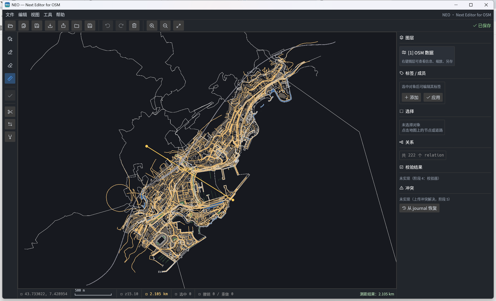

# 编辑操作

## 快捷键

| 按键 | 功能 |
|---|---|
| `S` / `A` / `X` / `M` | 选择 / 绘制 / 删除 / 测距 |
| `Enter` | 完成当前绘制的线 |
| `Delete` | 删除选中 |
| `Ctrl+Z` / `Ctrl+Y` | 撤销 / 重做 |
| `Ctrl+S` | 保存 XML |
| 左键点击 | 选中（红色高亮）；`Ctrl` 追加 |
| 左键拖拽 | 选中并移动节点/way |
| 右键拖动 | 平移地图 |
| 滚轮 | 以鼠标位置缩放 |

> 快捷键在输入框聚焦时不会触发（避免编辑标签时误操作）。
> 可在 **帮助 → 设置…** 查看当前绑定。

## 选择与移动

- 节点/way 有 **16px 可选择外边距**；两者独立，不会互相抢占。
- 左键拖拽命中要素会**先自动选中**再进入拖动；拖动中要素直接跟随，松开后记一条历史。
- 已选中的集合可直接从任意位置拖动；未命中要素时需要指针在选中要素 16px 外边距内。
- 点选/悬停时隐藏节点不可选择；隐藏节点下方的 way 仍可点击。**框选是纯几何选择**：缩放 LOD 未显示的节点也只要落在框内就会被选中。
- 选中或悬停 way 时（需 zoom ≥ 17），其全部节点以普通节点样式显示且可选；线段中点小三角**按下**即插入并拖动。
- 标签不允许空值：清空某个标签的值并离开编辑框后，该标签立即删除。

## 绘制

1. 按 `A` 或点击铅笔图标（点 / 线 / 面工具）
2. 依次点击地图添加节点（自动创建 way）；`空格` 等同左键落点
3. 线/面：`Enter` 完成（至少 2 个节点）；完成后自动选中新要素并回到**选择**工具。点工具落成一点后同样选中该点并回到选择
4. 绘制中右键单击：回退上一步绘制；若上一步不是绘制则不撤销
5. 新画面自带的 `area=yes` 在选用预设时会先清除，再写入预设标签（预设若含 `area=yes` 则重新带上）

### 吸附与续画

- 绘制时指针会吸附到附近节点或线段投影点（默认半径 16px，可在 **设置 → 编辑** 调整）。
- 吸附反馈只在画布上显示（高亮节点/线段、橡皮筋钉在吸附点），状态栏不提示。
- 按住 `Alt` 可临时关闭吸附。
- **线工具**、草稿为空时：点击某条未闭合 way 的端点，会载入该 way 并从该端继续追加（点到首端会先反转节点顺序）。
- 吸附到线段时，落点会新建共享节点并插入该 way（点 / 线 / 面工具均如此）。

## 路径操作

| 操作 | 条件 |
|---|---|
| 按点分割（剪刀工具） | 左侧工具栏/工具菜单选中「按点分割路径」，点击路径上的**内部节点**即分割经过它的所有路径（一次撤销） |
| 反转方向 | 选中路径；节点顺序反转 |
| 合并首尾相连路径（合并箭头） | 选中两条及以上**端点相邻**的路径；整条链合成一条，自动处理方向，一次撤销 |
| 简化 | 选中路径；按当前缩放容差做 RDP 简化 |
| 删除 | 删除选中对象；被引用的节点会被保护 |

工具菜单按类别分组排列：选择/绘制、测距、路径（分割↔合并、反转、简化）、节点（粘合↔解粘、对齐、等距分布、镜像）、面与其它几何。

## 预设与校验

- 选中对象后，标签面板顶部「预设…」搜索 **id-tagging-schema**。输入名称后同时出现 **name-suggestion-index** 的品牌建议（标有「品牌」）。选中后写入标签，并删掉过期的 `*:wikipedia`。
  再点「应用」提交；
- 右侧「校验结果 → 运行校验」检查 7 条内置规则，点击问题可定位对象。

## 标签编辑

右侧「标签 / 成员」表格：

- 直接修改 `key` / `value`，失焦即生效（值清空并失焦 = 删除该标签）
- `+ 添加` 新增一行；行尾 `×` 删除
- 选中多个对象时按**并集**显示所有选中对象的标签。某个标签并非所有对象都有、或值不一致时，值列显示「……」，点击可从下拉里选择已有值，选中后写入全部选中对象
- 一次编辑（含多选）通过同一个事务提交，`Ctrl+Z` 一步撤销

## 撤销与历史

- 所有数据修改走 Command/Transaction，`Ctrl+Z`/`Ctrl+Y` 可逆。
- 撤销栈默认保留全部会话内操作；关闭程序后通过 journal 恢复，见
  [文件、会话与恢复](files-and-sessions.md)。

## 图层只读

取消图层的「活动」开关后，数据灰显 50% 且不可编辑；重新勾选即可继续编辑。
多图层场景下只有活动图层可编辑。

## 测距

按 `M` 后点击起点、终点，显示黄色连线与距离（m/km）；再次点击开始新的测量。
测距不写入数据、不进入历史。

