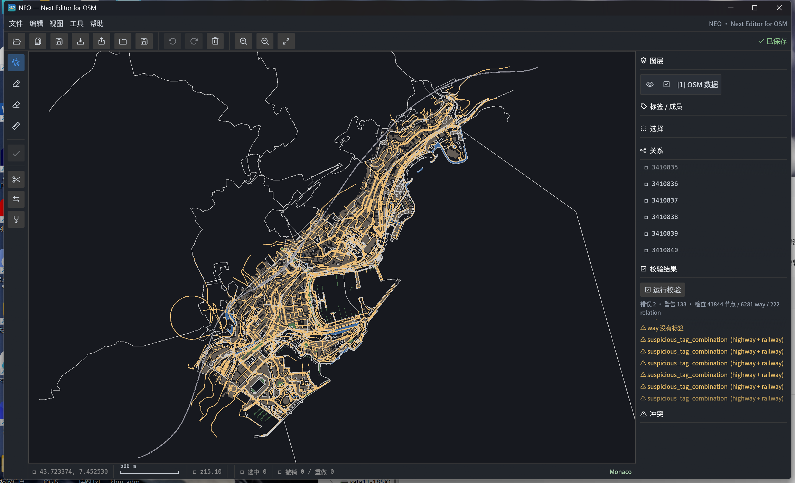
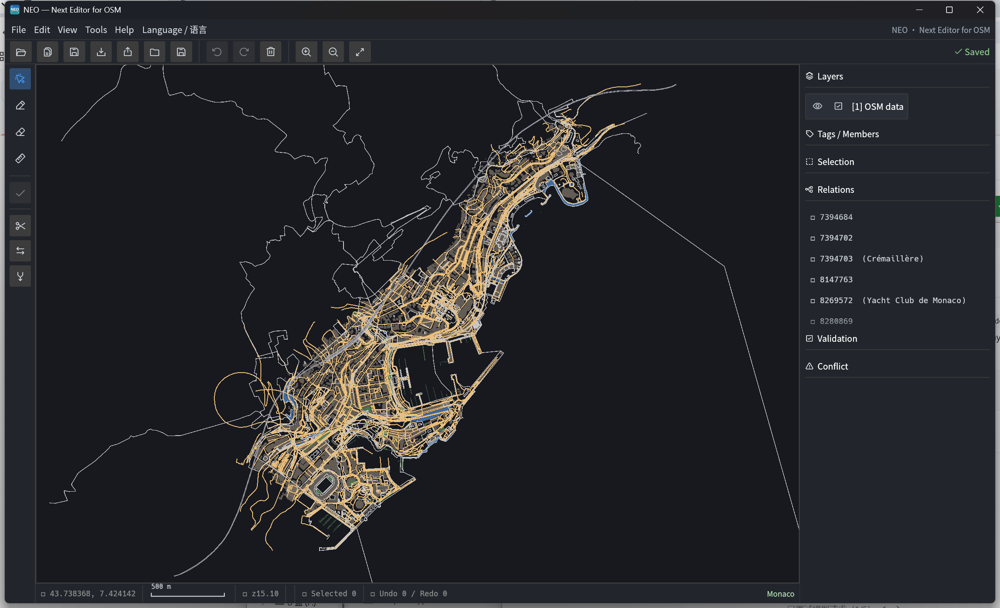

# Interface

NEO uses a JOSM-style layout (modern, dark theme):

```
┌ Menu bar: File / Edit / View / Tools / Help ───────────────────────────────┐
├ Common toolbar: Open/Save/Export · Undo/Redo/Delete · Zoom ────────────────┤
├──────┬─────────────────────────────────────────────┬───────────────────────┤
│Vert. │                                             │ Layers                │
│ tool │              Map canvas (wgpu)              │ Tags / Members        │
│ bar  │                                             │ Selection             │
│      │                                             │ Relations             │
│      │                                             │ Validation / Conflicts│
├──────┴─────────────────────────────────────────────┴───────────────────────┤
│ Lat/Lon · Scale · Zoom · Measure · Selection · Undo/Redo · Last action     │
└────────────────────────────────────────────────────────────────────────────┘
```

## Left toolbar

Select (S), Draw (A), Delete (X), Measure (M), plus Finish line (Enter),
Split way, Reverse direction, Merge two adjacent ways. The current tool is highlighted in blue.

## Right panels

### Layers

- **Eye icon**: show/hide the layer (when hidden the canvas is empty, but panning/zooming still work)
- **Checkbox**: whether this is the "active data layer"
- **Layer name**: right-click → `Info…` / `Zoom to Layer` / `Save As XML…`

**Inactive layer**: the GPU shader renders the data in **grayscale at 50% opacity** and makes it read-only:
selecting, dragging, drawing, and measuring are disabled (panning/zooming still work), and the selection is cleared automatically when switching.


### Tags / Members

After selecting an object, all tags are shown in a `key = value` table and can be edited, added, deleted, and applied directly.
A way shows its node member list; a relation shows its members (type / id / role). Empty when nothing is selected.

### Selection

Lists the currently selected objects; empty when nothing is selected.

### Relations

Lists all relations in the data set (id + name, if present); empty when there are none.

### Validation Results

Click "Run Validation" to execute 24 JOSM-style rules on the current data (way too short/long, adjacent and
non-adjacent duplicate nodes, duplicate coordinates, unclosed building/area, duplicate way, untagged
way/relation/node, empty relation, relation without `type`, duplicate relation members, suspicious tag
combinations, multipolygon role/no-outer/unclosed-outer problems, self-intersecting way, closed way with too
few nodes, invalid/out-of-range `layer`, invalid `oneway`, empty `name`). Results are listed as errors/warnings,
and clicking an entry selects and locates the corresponding object.



### Conflicts

Upload 409 conflicts are shown in the upload window: "Keep local and retry", "Take remote", "Merge tags", or "Merge geometry".
Manual merging (field/geometry selection) is still to come; `neo-editor::MergeCase` is already in place.

## Bottom status bar

- Latitude/longitude under the mouse (6 decimal places)
- Adaptive scale bar (m / km)
- Current zoom level
- Measurement result (when the measure tool is in use)
- Selection count, undo/redo stack lengths
- On the right: last action or error message

## Menus

| Menu | Contents |
|---|---|
| File | Open PBF/XML, Save XML, Export osmChange/PBF, Save/Open session |
| Edit | Undo, Redo, Delete selection, Recover from journal |
| View | Zoom in, Zoom out, Zoom to data |
| Tools | Select/Draw/Delete/Measure, Finish line, Split/Reverse/Merge way |
| Help | **Settings…** (language + shortcuts), **About NEO** (font overrides, licenses) |

## Node LOD and picking

| Zoom | Displayed | Pickable |
|---|---|---|
| z ≤ 16 | no nodes | ways only |
| z 17–18 | small dots for shared nodes (≥2 ways) | visible nodes + ways |
| z ≥ 19 | all nodes (shared = square, normal = circle) | all nodes + ways |

Hidden nodes do not intercept clicks on ways beneath them: the picking stage filters out invisible nodes and falls back to ways.


