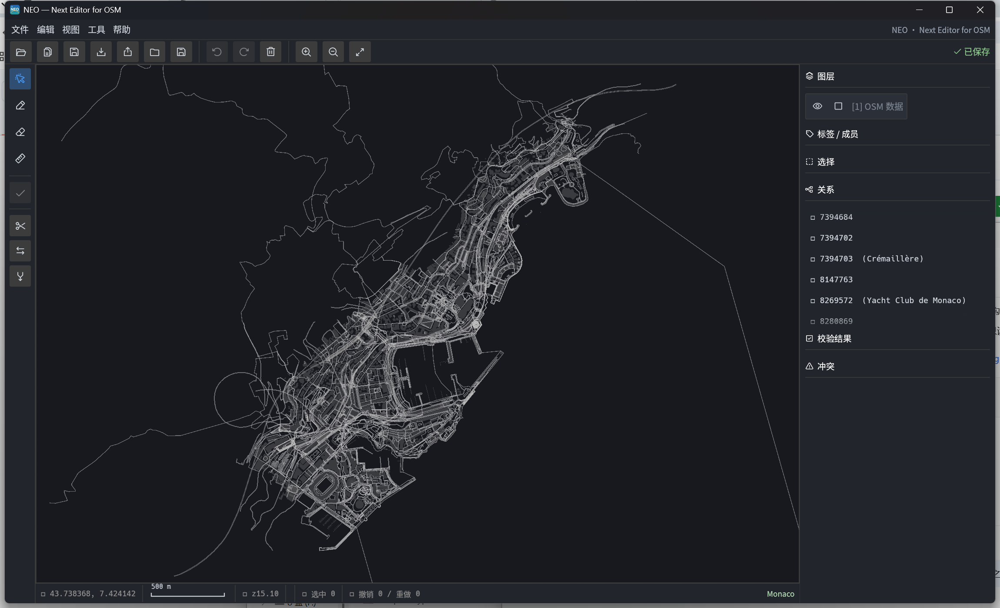

# 界面说明

NEO 采用 JOSM 风格布局（现代化、深色主题）：

```
┌ 菜单栏：文件 / 编辑 / 视图 / 工具 / 帮助 ─────────────────────────────┐
├ 常用工具栏：打开/保存/导出 · 撤销/重做/删除 · 缩放 ─────────────────────┤
├──────┬───────────────────────────────────────────┬───────────────────────┤
│ 竖排  │                                           │ 图层                  │
│ 工具  │           地图画布（wgpu）                  │ 标签 / 成员            │
│ 栏    │                                           │ 选择                  │
│      │                                           │ 关系                  │
│      │                                           │ 校验结果 / 冲突        │
├──────┴───────────────────────────────────────────┴───────────────────────┤
│ 经纬度 · 比例尺 · 缩放 · 测距结果 · 选中数 · 撤销/重做 · 最近操作          │
└──────────────────────────────────────────────────────────────────────────┘
```

## 左侧工具栏

选择（S）、绘制（A）、删除（X）、测距（M），以及完成线（Enter）、
分割 way、反转方向、合并两条相邻 way。当前工具为蓝色高亮。

## 右侧面板

### 图层

- **眼睛图标**：显示/隐藏图层（隐藏后画布为空，但可继续平移/缩放）
- **对勾方框**：是否为「活动数据图层」
- **图层名**：右键 → `信息…` / `缩放至图层` / `另存为 XML…`

**非活动图层**：GPU shader 把数据渲染为**灰度 + 50% 不透明度**，并进入只读：
不能选择、拖动、绘制、测距（平移/缩放可用），切换时自动清空选择。



### 标签 / 成员

选中对象后以 `key = value` 表格显示全部标签，可直接编辑、添加、删除、应用。
way 显示节点成员列表；relation 显示成员（type / id / role）。无选择时留空。

### 选择

列出当前选中对象；无选择时留空。

### 关系

列出数据集中全部 relation（id + name，若有）；为空时留空。

### 校验结果

点击「运行校验」对当前数据执行 12 条 JOSM 风格规则（way 少于 2 节点、相邻重复节点、
未闭合 building、重复 way、无标签 way/relation、空 relation、孤立未标注节点、重复坐标、
可疑标签组合、multipolygon 角色异常、way 自相交）。结果按错误/警告列出，
点击条目会选中并定位到对应对象。


### 冲突

上传 409 冲突显示在同步窗口：可「保留本地并重试」或「重新下载（放弃本地修改）」。
手合并（字段/几何选择）待后续；`neo-editor::MergeCase` 已就绪。

## 底部状态栏

- 鼠标所在经纬度（6 位小数）
- 自适应比例尺（m / km）
- 当前缩放级别
- 测距结果（使用测距工具时）
- 选中数、撤销/重做栈长度
- 右侧：最近操作或错误信息

## 菜单

| 菜单 | 内容 |
|---|---|
| 文件 | 打开 PBF/XML、保存 XML、导出 osmChange/PBF、保存/打开会话 |
| 编辑 | 撤销、重做、删除选中、从 journal 恢复 |
| 视图 | 放大、缩小、缩放至数据 |
| 工具 | 选择/绘制/删除/测距、完成线、分割/反转/合并 way |
| 帮助 | **设置…**（语言 + 快捷键）、**关于 NEO**（字体覆盖、许可） |

## 节点 LOD 与拾取

| 缩放 | 显示 | 可拾取 |
|---|---|---|
| z ≤ 16 | 无节点 | 只有 way |
| z 17–18 | 共享节点（≥2 条 way）小点 | 可见节点 + way |
| z ≥ 19 | 全部节点（共享=方块，普通=圆点） | 全部节点 + way |

隐藏节点不会拦截其下方 way 的点击：拾取阶段会过滤不可见节点并回退到 way。


