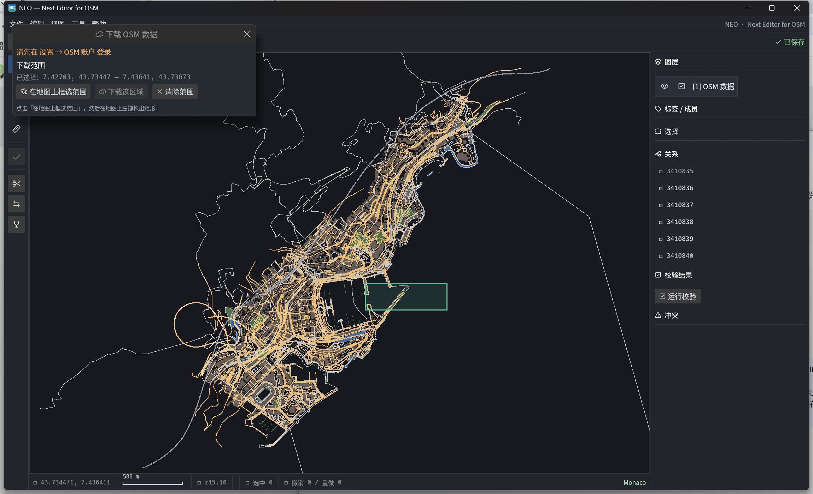
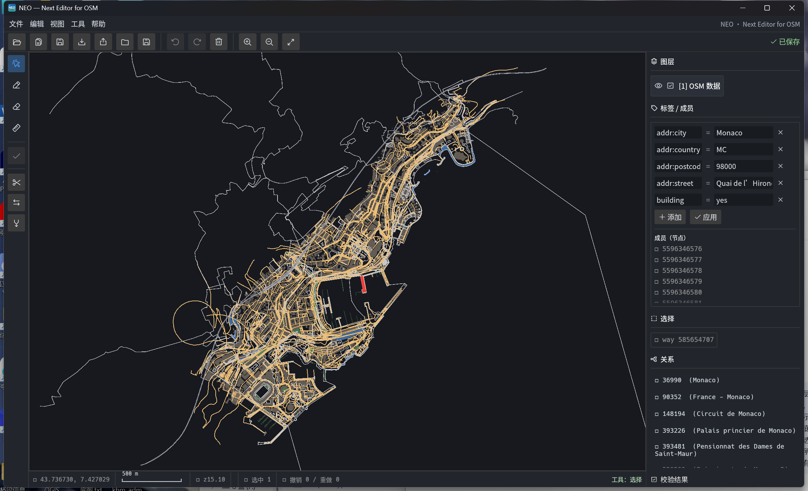
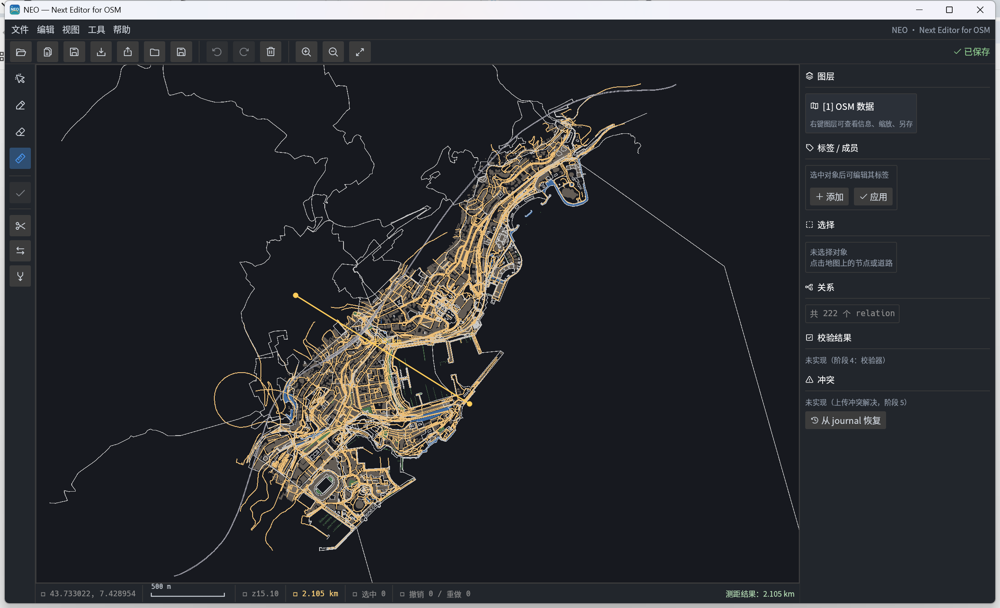

# Quick Start

## 1. Launch and open data

The map is empty after startup, so you need to load data yourself:

- **File → Open PBF…** to choose a `.osm.pbf`
- **File → Open OSM XML…** to choose a `.osm` / `.xml`
- Or use the toolbar's **Download OSM Data** to fetch an area from the API

The status bar shows progress when importing large files; `Esc`/the cancel button aborts a parallel import.

## 2. Download OSM Data (Optional)

The first toolbar icon (cloud download) opens the **Download OSM Data** window:

1. Click "Select area on map"
2. Drag a rectangle on the map with the left button (green box)
3. Click "Download this area" to download from the OSM API and replace the current layer

You can also import local files via **File → Open PBF… / Open OSM XML…**.

## 3. Navigation

| Action | Effect |
|---|---|
| Right drag | Pan the map |
| Wheel | Zoom centered on the mouse position |
| Toolbar zoom in/out/zoom to data | View operations |
| Bottom-left status bar | Mouse latitude/longitude + scale |

Nodes are shown according to the zoom level (LOD):

- `z ≤ 16`: nodes are not shown
- `z 17–18`: only nodes shared by ≥2 ways are shown (small dots)
- `z ≥ 19`: all nodes are shown (shared nodes as squares, normal nodes as circles)

## 4. Selecting and inspecting

- **Select tool (S)**: left-click a feature to highlight it in red; Ctrl+click appends to the selection
- The **Tags / Members** panel on the right shows all tags; ways/relations show their members at the bottom
- The **Relations** panel lists all relations; the **Selection** panel lists the current selection
- Right-click a layer → **Info…** to see counts, version, dirty objects, and viewport center

## 5. Editing

- **Left drag**: drag a node or an entire way (it is auto-selected first; data is written only on release)
- **Draw (A)**: click in sequence to draw a line, `Enter` to finish
- **Delete (X)**: click a feature to delete it
- **Ctrl+Z / Ctrl+Y**: undo/redo
- **Delete**: delete the current selection
- Split / Reverse / Merge buttons are in the left toolbox and the toolbar

## 6. Saving

- **File → Export…** opens the unified export window; choose OSM XML / osmChange / PBF / JOSM session
- **Ctrl+S** quickly saves XML
- Exporting a session (`.jos`/`.joz`) preserves the view and selection

## 7. Measuring

Press `M` or click the ruler icon on the left: the first click sets the start point, the second sets the end point,
the map shows a yellow line and the distance, and the status bar synchronously shows m/km.

## 8. Next steps

- [Interface](interface.md) — what each panel is for
- [Editing Operations](editing.md) — details and shortcuts
- [Files, Sessions and Recovery](files-and-sessions.md) — data safety
