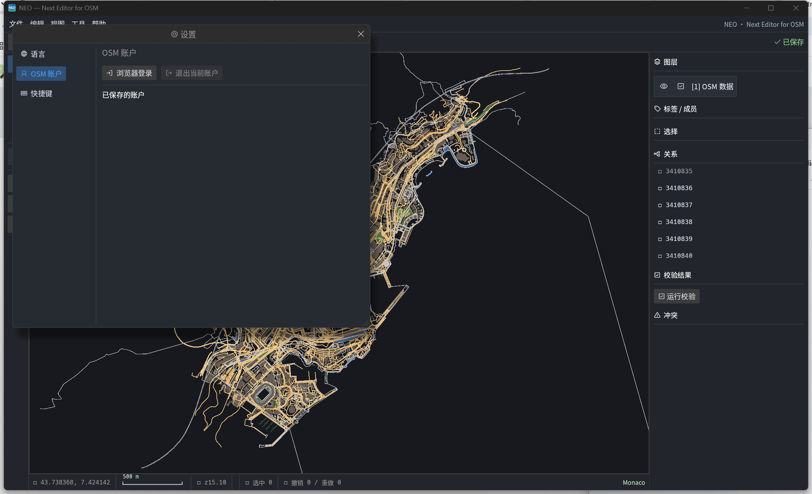

# 设置与多语言

## 设置窗口

入口：**帮助 → 设置…**（齿轮图标）。包含：

### 语言 / Language

- **中文**（默认）与 **English**
- 点击即时生效，无需重启
- 也可用环境变量指定：`NEO_LANG=en-US` / `NEO_LANG=zh-CN`

### 快捷键

列出当前内置绑定：`S/A/X/M`、`Enter`、`Ctrl+Z/Y/S`、`Delete`，以及鼠标操作。
0.1.0 为只读展示；可配置绑定计划在后续版本加入。



## OSM 账户（OAuth2 + PKCE）

设置窗口左侧选择 **OSM 账户**：

NEO 内置 OAuth 客户端（授权码 + PKCE），无需填写 client_id 或密钥：

1. 点「浏览器登录」
2. 浏览器授权后自动回调本地端口，换取 token 并保存
3. 已登录账户显示在列表中，可切换/删除

登出/删除只影响本地记录，不会撤销服务端授权。

## 关于窗口

**帮助 → 关于 NEO**：版本、字体覆盖示例（检查是否出现方框）、
图标/字体/数据许可说明。

## 字体

界面文本优先用系统 CJK，再加载旁路 `assets/fonts/` 中的 OFL 字体（不编进 exe）：

| 字体 | 覆盖 | 许可 |
|---|---|---|
| Noto Sans CJK SC | 中日韩 | SIL OFL 1.1 |
| GNU Unifont | Unicode BMP 全量兜底 | OFL 1.1 / GPLv2+ 字体嵌入例外 |
| GNU Unifont Upper | SMP / Plane 2 / 3 | 同上 |
| Phosphor Icons | 界面图标 | MIT |

许可证全文：`assets/fonts/OFL-1.1.txt`、`assets/fonts/NOTICE.md`。

## 对开发者：i18n

所有用户可见文本位于仓库根目录 `i18n/`：

```
i18n/
├── zh-CN.json
├── en-US.json
└── README.md
```

- 代码：`use neo_i18n::{t, tf};` → `t("menu.file")`、`tf("status.selected", &[("n","3")])`
- 编译期 `include_str!` 嵌入，release 不依赖外部文件
- 新增文本需同时改中英两份 JSON；`cargo test -p neo-i18n` 检查 key 对齐，
  `python scripts/check-i18n.py` 检查代码用到的 key 是否缺失
- 新增语言：添加 JSON + 在 `crates/neo-i18n/src/lib.rs` 的 `Lang` 枚举中登记
  （当前为编译期双语表；如需任意语言可扩展为目录扫描）
