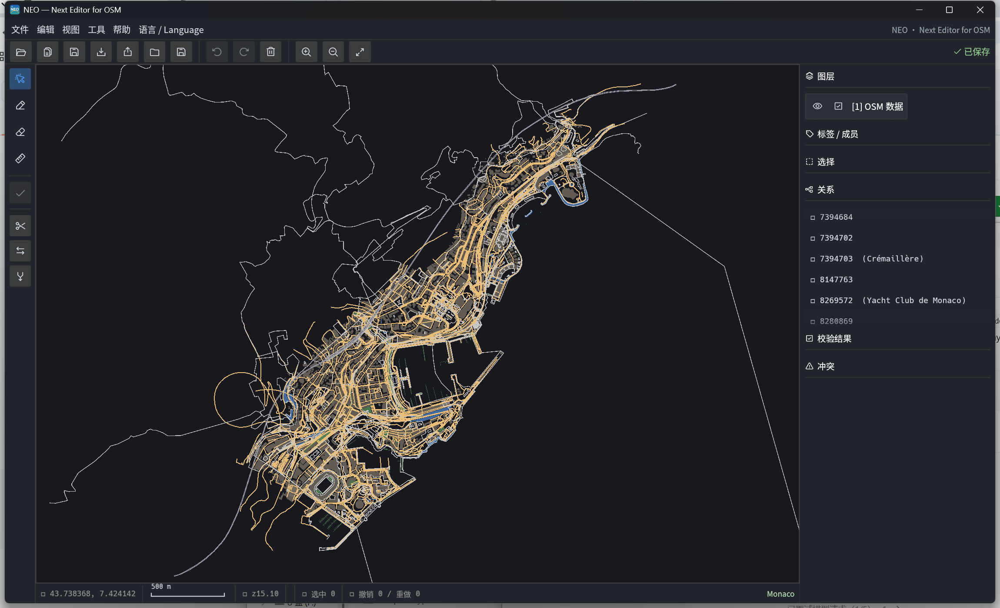

# NEO — Next Editor for OSM

**A native Rust, GPU-first OpenStreetMap editor**, aiming to be a complete replacement for JOSM rather than a lightweight map viewer.

- Platforms: Windows 10/11 (primary), Linux / macOS buildable from source
- Scale: from one million to tens of millions of OSM objects
- Architecture: Rust Core + wgpu Renderer + egui UI + parallel engine

> Current version **0.1.0**: Phase 2 (data core) and Phase 3 (editing) are complete; **Phase 4 is in progress**.
> Delivered: a JOSM-style validator (24 rules + panel navigation), id-tagging-schema and name-suggestion-index presets, an OSM API 0.6 protocol client (changeset/diff/409 parsing),
> a conflict merge model (MergeCase + 6 classes of tests), and journal recovery reports.
> Still pending: MapCSS render integration, real HTTP upload UI, autosave, conflict resolution UI.

## This documentation site

- **User guide**: installation, quick start, interface, editing, files and sessions, settings, performance, FAQ
- **Developer guide**: architecture, workspace, build and test, contribution workflow, release workflow
- **Technical design**: `docs/01`–`docs/18` and the ADRs, the source of truth for the architecture

## Links

- Code repository: <https://github.com/TrapMeHere/NEO>
- Issue tracker: <https://github.com/TrapMeHere/NEO/issues>
- Releases: <https://github.com/TrapMeHere/NEO/releases>
- Development progress: [`TODO.md`](https://github.com/TrapMeHere/NEO/blob/master/TODO.md) in the repository root

## License

Code is dual-licensed under **Apache-2.0 OR MIT**; documentation is under **CC-BY-SA-4.0**;
see [NOTICE](https://github.com/TrapMeHere/NEO/blob/master/NOTICE) for the licenses of fonts/icons and OSM data.
